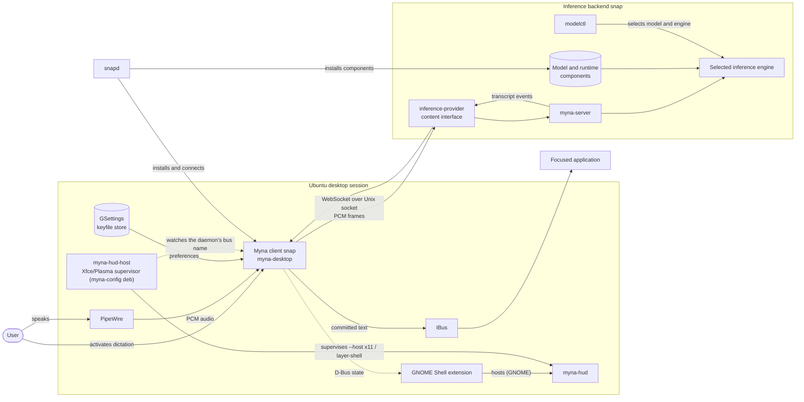

# Preface

Read this document for a visual overview of Myna's runtime components and trust boundaries. Use the subsystem diagrams for implementation-level structure.

Read the top-level `.kb/agents.md` file before continuing below.

# Important

- Myna is offline: no component needs the network for its core function, and nothing falls back to a remote service or downloads at session time. `client/deny.toml` bans network client crates from the client.
- Captured audio lives only in bounded in-memory buffers and is never persisted by default. Transcript text never leaves the injection path: the D-Bus status, the HUD and logs carry state and energy only. The one exception is a `processing-chain` other than `exact`, the default: while one is chosen, the dictation in progress is published on the session bus as `DraftText` and `DraftTail` for the Shell extension to draw, and sent to the text model socket. It is still never logged, and persisted only while `processing-history` is on.

# Architecture

The HUD has two hosts: on GNOME the Shell extension starts and positions it, and on Xfce and Plasma `myna-hud-host` (shipped in the myna-config deb, started by an XDG autostart entry) runs `myna-hud --host x11`, or `--host layer-shell` on Wayland, only while the daemon owns its D-Bus name, and the HUD places its own window.

The client is the only component with microphone and desktop access. Inference backends receive PCM through a connected local Unix socket and do not access the network or microphone. A backend shares its socket through an `inference-provider` content slot whose directory holds a `provider.env` naming the snap, the socket, and `MYNA_ROLE=speech` (`MYNA_ROLE=text` for Myna's text snap); the client partitions connected shares by role so text and LLM providers coexist alongside the one active speech provider, refusing to choose only when more than one speech provider serves. Unstable text remains presentation state; only committed text reaches IBus.
